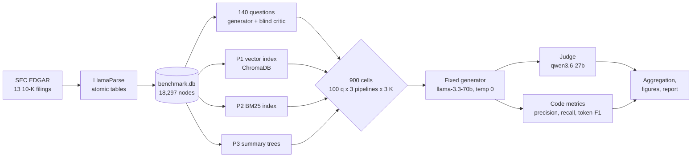
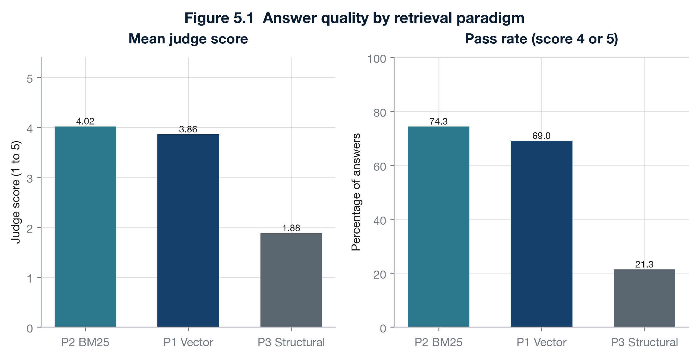
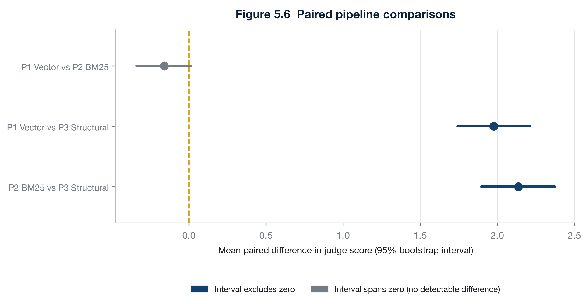
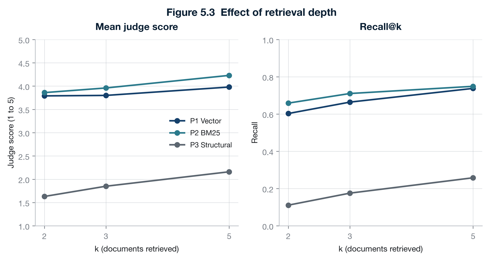

# RAGBench-10K

[](https://www.python.org/)
[](LICENSE)
[](#tests)

**A controlled benchmark of three retrieval paradigms, vector, BM25 and summary-tree, over 13 SEC 10-K filings, with generation held fixed so only retrieval varies.**

## TL;DR

- **BM25 is statistically indistinguishable from a dense retriever plus reranker at this sample size.** BM25 scores 4.02 and vector 3.86 on a 1 to 5 judge scale. The paired difference is -0.160 with a 95% interval of [-0.340, +0.013], which crosses zero.
- **The summary-tree pipeline scores 1.88, around two judge points lower**, and its intervals sit well clear of zero. In 214 of its 300 cells it answered that the sources did not contain the answer, against 60 for BM25 and 62 for vector.
- **The build costs span more than four orders of magnitude.** Under 1 second for BM25, 22 minutes for the vector index, and 10.6 hours plus 1.6M input and 892K output tokens for the summary trees.

**Scale:** 13 filings, 5 companies, 18,297 nodes, 140 questions of which 100 are scored, 900 benchmark cells, one run per cell at temperature 0. The judge cleared its 80% gate at 86.7%, 52 of 60, measured as [concordance against blind reference scores](#how-answers-are-scored), not against human labels.

**Quick links:** [Results](#results) · [Run the demo](#part-1-run-the-demo) · [The run data](#the-run-data) · [Full run](#part-2-run-the-full-project) · [Experimental design](#experimental-design) · [Limitations](#limitations)

---

## Try it in two minutes, no API key

```bash
git clone git@github.com:ojaswiat/ragbench-10k.git ragbench-10k
cd ragbench-10k
uv sync
uv run python -m demo.main
```

That runs four questions through all three pipelines on one filing, on your CPU, with no account and no key. [Full detail below.](#part-1-run-the-demo)

---

## The research question

The question is deliberately narrow. **When the source material is dense financial prose and tables, does the choice of retrieval strategy change the quality of the answer, and where does each strategy break down?**

Generation is held fixed across all three pipelines. The same model answers every question with the same settings, so any difference in score comes from retrieval and nothing else.

### The three pipelines

| ID | Paradigm | How it retrieves |
|---|---|---|
| `P1_vector` | Semantic | `bge-small-en-v1.5` embeddings in ChromaDB, then a local cross-encoder reranker |
| `P2_bm25` | Statistical | Okapi BM25 with a custom tokeniser that keeps numbers, decimals, percentages and currency |
| `P3_structural` | Structural | Walks a per-filing summary tree from root to leaf |

Design decisions worth knowing before you read the numbers:

- **P1** gets no metadata filter and no section head start, so it cannot narrow the search before it begins. The cross-encoder reranks the shortlist, which is why it is the slowest of the three to retrieve.
- **P2** has no model anywhere in its retrieval path, which keeps the semantic versus statistical contrast clean. Its tokeniser deliberately preserves `$12,345`, `3.5`, `14.2%` and similar tokens that a stock tokeniser would split or drop. Whether that choice explains BM25's result is a reasonable hypothesis, **not something this benchmark establishes**: there is no tokeniser ablation here.
- **P3** reuses a summary tree built once per filing, never rebuilt at query time. Retrieval walks root to leaf and returns the leaf summaries, not the original nodes.

### Architecture



---

## Results

All 900 per-cell results ship in `results/benchmark-run.db` (648 KB), so every figure and table below regenerates on your machine in seconds. [How to use it.](#the-run-data)

### Answer quality



*Figure 5.1. Mean judge score and pass rate, 300 cells per pipeline. Bars are means without intervals; the intervals are in Figure 5.6.*

### Is the P1 versus P2 gap real?



*Figure 5.6. Mean paired difference in judge score with 95% bootstrap intervals, paired on question and K.*

| Comparison | Difference | 95% CI | W/L/T | p | Clears zero |
|---|---|---|---|---|---|
| P1_vector vs P2_bm25 | -0.160 | [-0.340, +0.013] | 27/42/231 | 9.12e-02 | no |
| P1_vector vs P3_structural | +1.977 | [+1.743, +2.213] | 169/11/120 | 1.64e-37 | yes |
| P2_bm25 vs P3_structural | +2.137 | [+1.897, +2.373] | 180/12/108 | 1.26e-39 | yes |

Read the first row carefully. **This is "no significant difference at n=100", not "equal".** The interval's upper bound is +0.013, so it only just includes zero, and BM25 wins 42 of the 69 cells where the two disagree. A hundred questions cannot rule out a small real advantage to BM25. The honest claim is that a well-tokenised BM25 index is competitive with a dense retriever plus reranker on this material, not that the two are the same.

### Cost against quality

One row per pipeline, build cost and answer quality side by side. Build figures are one-off, measured on the full 13-filing corpus.

| Pipeline | Judge | Pass rate | Recall@K | Build time | Build tokens | Index on disk | Model at build |
|---|---|---|---|---|---|---|---|
| `P2_bm25` | **4.02** | 74.3% | 0.706 | **under 1 s** | 0 | 7 MB | no |
| `P1_vector` | 3.86 | 69.0% | 0.668 | 22 min | 0 | ~142 MB | no, local CPU |
| `P3_structural` | 1.88 | 21.3% | 0.181 | **10.6 h** | 1.60M in, 892K out | 28 MB | yes |

The pipeline that costs nothing to build scores highest. That is the uncomfortable part of this result, and it is the reason the benchmark is worth running.

A note on the P3 token counts: they are a **floor** over 11 of the 13 filings. JPM_2023 and JPM_2024 were built before the token log recorded usage, so the true figure is higher.

### The effect of retrieval depth



*Figure 5.3. Judge score and recall@K at K = 2, 3 and 5.*

| Pipeline | K | Judge | Pass | Recall | Hit rate |
|---|---|---|---|---|---|
| `P1_vector` | 2 | 3.79 | 0.670 | 0.603 | 0.760 |
| `P1_vector` | 3 | 3.80 | 0.670 | 0.664 | 0.800 |
| `P1_vector` | 5 | 3.98 | 0.730 | 0.738 | 0.860 |
| `P2_bm25` | 2 | 3.86 | 0.700 | 0.659 | 0.800 |
| `P2_bm25` | 3 | 3.96 | 0.730 | 0.710 | 0.850 |
| `P2_bm25` | 5 | **4.23** | **0.800** | 0.749 | 0.870 |
| `P3_structural` | 2 | 1.63 | 0.150 | 0.111 | 0.130 |
| `P3_structural` | 3 | 1.85 | 0.210 | 0.175 | 0.200 |
| `P3_structural` | 5 | 2.16 | 0.280 | 0.258 | 0.290 |

More context helps every pipeline. Between K = 2 and K = 5, BM25 gains 0.37 judge points against vector's 0.19, which is what widens the gap at K = 5. P3 gains the most in absolute terms, 0.53 points, but from so far back that K = 5 still leaves it below where the other two start at K = 2.

### By question type

Questions sit in four quadrants, crossing factual against analytical and text-sourced against table-sourced.

| Quadrant | `P1_vector` | `P2_bm25` | `P3_structural` |
|---|---|---|---|
| Q1 Direct text | 4.47 | **4.80** | 1.95 |
| Q2 Implicit text | 3.41 | **3.92** | 1.71 |
| Q3 Direct table | 4.31 | **4.35** | 1.95 |
| Q4 Implicit table | **3.24** | 3.00 | 1.92 |

Mean judge score. The one quadrant where vector beats BM25 is Q4, analytical questions over tables, where the wording of the question is least likely to share tokens with the source. That is the shape you would predict, and it is also the only quadrant where BM25 falls as low as 3.00.

### Where P3 breaks down

The summary tree does not usually retrieve the wrong part of the filing. It retrieves roughly the right section and finds that the number has been summarised away. **In 214 of its 300 cells the answer was a variant of "the sources do not contain the answer",** against 60 for BM25 and 62 for vector.

Two examples from the run, both at K = 5, both scored 1 by the judge:

> **Q.** What was the number of full-time equivalent (FTE) positions for Johnson & Johnson as of December 31, 2023?
> **Ground truth:** 131,900
> **P3:** "The sources provided do not contain the answer to the question regarding the number of full-time equivalent (FTE) positions..."
> **P2 on the same question:** "The number of full-time equivalent (FTE) positions for Johnson & Johnson as of December 31, 2023, was 131,900." Judge score 5.

> **Q.** What is the total number of leased facilities internationally according to the table?
> **Ground truth:** 22
> **P3:** "The sources do not contain the answer."
> **P1 and P2 on the same question:** both returned 22 from the correct node. Judge score 5 each.

In both cases P3's cited nodes come from the right neighbourhood of the filing. The cell value simply did not survive summarisation. This is a finding about **this summarisation implementation**, not about tree retrieval as a family. A tree that kept leaf nodes verbatim, or that fell back to the source node once it reached a leaf, would be a different experiment.

### A word on the latency column

The two latency figures in this README measure **different things**, and neither is end to end.

| Where it appears | What it measures | Typical values |
|---|---|---|
| Demo summary table | **Retrieval only**, wall clock around the retriever call | P2 0.02 s, P3 3.88 s, P1 4.94 s |
| Full-run `lat` column | **Generation only**, wall clock around the answerer's LLM call | P2 6.18 s, P1 6.40 s, P3 6.87 s |

That is why the full run shows all three within a second of each other: they share one generator on one provider, so that column is mostly measuring Groq, not the pipeline. The retrieval cost difference is real and large, and it is the demo column that shows it. If you want end-to-end numbers, add the two together, but be aware the generation half is network-bound and will move with provider load.

---

## The run data

**Every number above ships with the repository.** You do not have to take any of them on trust, and you do not have to spend three weeks of free-tier quota to check them.

`results/benchmark-run.db` is a 648 KB SQLite file holding the complete output of the run reported here:

| Table | Rows | What it holds |
|---|---|---|
| `results` | 960 | Every benchmark cell: 900 scored PQ cells plus the 60 judge-gate rows. Retrieved and cited node IDs, the full answer text, all metrics, the judge score |
| `queries` | 100 | The scored question set, with ground-truth answers and citations |
| `golden_queries` | 20 | The labelled judge exemplars |
| `judge_validation` | 20 | The gate question set |
| `nodes` | 0 | Emptied. The 18,297-node store is 10 MB and rebuilds from step 1 |

Point any analysis script at it with `--db`:

```bash
uv run python -m analysis.aggregate_results --db results/benchmark-run.db
uv run python -m reporting.build_figures     --db results/benchmark-run.db
uv run python -m reporting.build_report      --db results/benchmark-run.db
```

Or query it directly, which is often faster than reading a table:

```bash
sqlite3 results/benchmark-run.db \
  "select pipeline, round(avg(judge_score),2) from results
   where source_set='PQ' group by pipeline order by 2 desc"
```

### How reproducible is this, exactly?

Two different questions get confused here, so it is worth separating them.

**Re-analysing the shipped data is exact, not approximate.** The bootstrap is seeded, so the intervals do not wander between runs. Regenerating the six figures from `results/benchmark-run.db` reproduces the committed PNGs **byte for byte**, and every table in this README comes back identical. If you get a different number, something is wrong, and that is the point of shipping the file.

**Re-running the benchmark from scratch is a different matter, and the change is more than slight.** Step 3 generates the question set with a model, so a fresh run writes a different 140 questions. The scores move with them, and the move is not a rounding wobble: absolute judge scores can shift by a few tenths of a point in either direction. What should survive is the *shape*, that P1 and P2 land close enough to be indistinguishable and P3 trails badly on anything depending on a value inside a table. Treat the headline numbers as specific to this question set, and the ordering as the finding.

So: cite the numbers from the shipped data, and expect your own full rerun to differ.

---

## Experimental design

| Item | Setting |
|---|---|
| Corpus | 13 SEC 10-K filings, 5 companies at uneven year depth: AAPL, MSFT and TSLA for FY2023 to FY2025, JPM and JNJ for FY2023 to FY2024 |
| Parsing | LlamaParse in atomic-table mode, so a table is never cut in half. 18,297 nodes |
| Question sets | 140 total, three disjoint sets: 100 primary (scored), 20 golden (judge exemplars only), 20 validation (judge gate only) |
| Question types | Four quadrants: factual or analytical, crossed with text-sourced or table-sourced |
| Retrieval depth | K in {2, 3, 5} |
| Cells | 900 = 100 questions x 3 pipelines x 3 values of K |
| Sampling | One run per cell, temperature 0, no repeated sampling |
| What is held fixed | Generator model, prompt, temperature, question set, node store |
| What varies | Retrieval, and nothing else |
| What pipelines see | The question and their own retrieved nodes. No exemplars, no ground truth, no answer-location hints, no metadata pre-filter for P1 |
| Judge gate | 60 validation outputs scored twice, blind to pipeline identity, must agree above 80%. Cleared at 86.7%, 52 of 60. Cross-model concordance, not human agreement |
| Intervals | 95% bootstrap, paired on question and K. They describe variation across questions, not run-to-run variance |

### How answers are scored

Three pillars:

1. **Retrieval:** precision@K, recall@K, evidence hit rate. Set arithmetic against stored ground-truth node IDs, no model involved.
2. **Answer quality:** a judge model scoring 1 to 5, backed by citation auditing, token-F1 and numeric exact match done in code.
3. **Efficiency:** latency, tokens spent, and what it cost to build each index in the first place.

The judge has to earn its place before it grades anything. It scores the 60 validation outputs, a second scorer scores the same 60 independently, and the two must agree on more than 80%. It cleared at **86.7%**, 52 of 60. The judge sees only the five exemplars matching the question's quadrant, never all 20, and it has no search tool.

**Be precise about what that 86.7% is.** The reference scores were produced by a model, not by a human, so the figure is **cross-model concordance, not human agreement**, and `judge_score` is not externally validated. What the gate does buy is independence, enforced structurally rather than by the scorer's good intentions:

- **Evidence parity.** The reference scorer sees exactly the fields the judge sees. Ground-truth citations are withheld from both, so a disagreement cannot be an artefact of one side having better evidence.
- **Pipeline blindness.** The pipeline name and the result ID that encodes it are stripped and replaced with opaque tokens. Rows are shuffled with a fixed seed first, because the natural sort order puts the same pipeline in every third row and position alone would leak it. A scorer who could tell an answer came from P3, the pipeline this project predicts will do worst, could shade the result it was meant to test.

The 8 disagreements are worth reporting in full, because their shape matters more than the headline. **Every one is off by exactly one point**, and they fall on just three questions, hitting all three pipelines together on two of them:

| Question | Pipelines affected | Judge | Reference |
|---|---|---|---|
| QT1_JEQ_001 | all three | 5 | 4 |
| QT3_JEQ_003 | P2, P3 | 5, 2 | 4, 1 |
| QT4_JEQ_001 | all three | 4 | 5 |

The judge is the more generous scorer in 5 of the 8 and the stricter in 3, so there is no consistent leniency bias. More usefully, the disagreements cluster by **question**, not by pipeline: they are a handful of genuinely borderline items that both scorers found hard, rather than a systematic tilt for or against any one retrieval strategy. A bias that tracked pipeline identity would be fatal to the headline comparison. This one does not.

The 60 gate rows are kept, so hand-scoring them later would upgrade the claim to real human validation without repeating any paid work.

### Model routing, and why it is split

Roles are pinned so that no model ever marks its own family's work.

| Role | Model | Provider |
|---|---|---|
| Question generator | `nvidia/nemotron-3-super-120b-a12b:free` | OpenRouter |
| Question critic | `openai/gpt-oss-20b:free` | OpenRouter |
| P3 index build | `nvidia/nemotron-3-super-120b-a12b` | NVIDIA NIM |
| Pipeline answerer | `llama-3.3-70b-versatile` | Groq |
| Judge | `qwen/qwen3.6-27b` | Groq |

This is a deliberate bias-mitigation choice, not an accident of what was free. The generator and the critic are different families, so a question is never checked by the model that wrote it. The answerer and the judge are different families, so an answer is never graded by the model that produced it. Without that separation, an LLM-judged benchmark measures family affinity as much as answer quality.

---

# Part 1: Run the demo

**Start here.** It shows you what the project does in about two minutes, and it needs no API key at all.

### What you need

- Python 3.13
- [uv](https://docs.astral.sh/uv/)
- Nothing else. No account, no key, no `.env` file.

### Steps

```bash
git clone git@github.com:ojaswiat/ragbench-10k.git ragbench-10k
cd ragbench-10k
uv sync
uv run python -m demo.main
```

### What it does

- Takes one filing, Microsoft's FY2023 10-K, which is 1,103 nodes.
- Picks one question from each of the four quadrants, so four questions in total.
- Sends each question through all three pipelines at K = 3.
- Prints the ranked evidence each pipeline returned, and marks which nodes were correct.
- Scores precision@3 and recall@3 against the citations already stored with the question.
- Finishes with a summary table and a plain explanation of how each pipeline succeeded or failed.

### What it costs

- **No API calls, and no key is read.** P1 embeds on your CPU, P2 is pure arithmetic, and P3 walks its tree with a mock model standing in for a real one.
- The scores are set arithmetic against stored citations, not a model's opinion.

### How long it takes

- **First run: about two minutes.** Most of that is downloading the embedding model and the reranker, then embedding 1,103 nodes.
- **Later runs: about 45 seconds.** Both indexes are cached on disk by then.

### What you should see

For each of the four questions the run prints the ground-truth node, then the three nodes each pipeline returned, with a `*` marking the ones that were correct. It ends with this summary:

```
==============================================================================
  SUMMARY   ·   mean over 4 queries at K=3
==============================================================================
                      Precision@3    Recall@3    Mean latency
                   ------------------------------------------
  P1  semantic               0.42        0.69           4.94s
  P2  statistical            0.50        0.75           0.02s
  P3  structural             0.00        0.00           3.88s
```

Reading the columns:

- **Precision@3**: of the three nodes a pipeline returned, the fraction that were in the ground truth. Higher is better.
- **Recall@3**: of the nodes the ground truth lists, the fraction the pipeline found. Higher is better.
- **Mean latency**: average time to **retrieve** the evidence for one question. Retrieval only, no generation. See [the note on latency](#a-word-on-the-latency-column).

What it tells you:

- P1 and P2 land close together, which is the headline result in miniature.
- P3 misses on all four questions, so it scores zero on both measures.
- P2 is two orders of magnitude faster than P1, because it runs no model and does no embedding.
- Your latency figures will differ, since they depend on your machine. The pattern should not.

### Why two files ship with the repository

The demo needs a node store and a P3 summary tree, and neither can be made offline:

- The node store comes out of a paid parse of the source filing.
- The summary tree is built by running a model over every node.

Both are included in `demo/assets/` for that one filing, 2.3 MB in total, and copied into place on the first run. If you already have a real `benchmark.db`, the demo leaves it alone. The P1 and P2 indexes are not shipped, because they build locally in seconds.

### One honest caveat

Four questions on one filing shows you the mechanism. It is not a finding. The finding is the 900-run benchmark in Part 2.

---

# Part 2: Run the full project

This rebuilds the whole thing from nothing. It needs your own API keys, and **it takes two to three weeks of intermittent running on free tiers**, because it is limited by daily token caps rather than by speed. Read [Reproducibility](#reproducibility) before you commit to it.

### What you need

Copy the template and fill in your keys:

```bash
cp .env.example .env
```

| Variable | What it is for | Where to get one |
|---|---|---|
| `LLAMA_CLOUD_API_KEY` | Parsing the filings | [cloud.llamaindex.ai](https://cloud.llamaindex.ai/api-key) |
| `NIM_API_KEY` | Building the P3 summary trees | [build.nvidia.com](https://build.nvidia.com) |
| `OPENROUTER_API_KEY` | Generating and checking the questions | [openrouter.ai/keys](https://openrouter.ai/keys) |
| `GROQ_API_KEY` | Answering questions and judging answers | [console.groq.com](https://console.groq.com/keys) |
| `SEC_EDGAR_USER_AGENT` | Not a key. The contact string EDGAR asks for | Your own `"name email"` |

All four services have a free tier. The project is built to stay inside them.

### Hardware and disk

- **Any modern laptop will do.** No GPU is needed or used. Embedding and reranking run on CPU through ONNX Runtime; everything expensive is somebody else's API.
- **Allow about 2 GB of free disk**, measured on a completed run:

| What | Size |
|---|---|
| Virtual environment | ~570 MB |
| Cached model weights in `~/.cache/rag-techniques/` | up to ~1 GB |
| Raw filings (`data/raw/`) | 90 MB |
| Parsed markdown (`data/parsed/`) | 10 MB |
| Indexes (`storage/`) | ~177 MB |
| `benchmark.db` | 11 MB |

- The run is network-bound, not compute-bound. You can leave it and come back.

### Read this before you start

- **`LOCAL_TEST_THROTTLE` defaults to `true`.** While it is on, every stage stops after three items: three filings, three sections, three benchmark cells, three judge rows.
- Leave it on for your first pass. It proves the whole chain works for a few pennies of quota.
- Set it to `false` in `.env` when you want the real run.
- Run every command from the repository root. Paths are worked out from your working directory.
- Steps 2 and 6 are the expensive ones. Everything else is cheap or free.

**If you ran the demo first, clear its state before you start.** The demo seeds `benchmark.db` with the nodes and 16 questions for its one filing, and ingestion skips any filing that already has nodes. Left in place, those 16 would be counted towards the question set and you would end up with a mix of bundled and freshly generated questions.

```bash
rm -rf benchmark.db benchmark.db-wal benchmark.db-shm storage artifacts
```

That command removes the database with its two sidecar files, then `storage/`, then `artifacts/`. **The database and `storage/` must go together, both or neither:** keeping `storage/` while deleting the database leaves a summary tree pointing at node IDs that no longer exist. `artifacts/` is unrelated to that rule. It holds only generated output, so you can delete it or keep it without affecting anything. Nothing here is precious: the demo rebuilds its own state the next time you run it.

---

### Step 1. Download and parse the filings

```bash
uv run python -m ingest.run_ingestion
```

- Downloads 13 10-K filings from SEC EDGAR against a pinned manifest, so you get the same documents every time.
- Sends each one to LlamaParse in atomic-table mode, so a table is never cut in half.
- Builds nodes and writes them to SQLite, creating `benchmark.db` and its five tables on the first run.
- Gives every node a stable ID, its parent section heading, a text or table type, and a page number for display only.
- **Produces**: 18,297 nodes, about 90 MB of raw filings and 10 MB of parsed markdown.
- **Time**: varies with the LlamaParse queue. This is the slowest stage that does not involve an LLM.
- Parsed output is cached, so running it again does not pay to parse twice.

### Step 2. Build the three indexes

```bash
uv run python -m pipelines.vector.build_vector_index
uv run python -m pipelines.bm25.build_bm25_index
uv run python -m pipelines.structural.build_summary_index
```

These are very different jobs, and the difference is itself one of the results. Measured on the full 13-filing corpus:

| Index | Time | Tokens | On disk | Uses a model |
|---|---|---|---|---|
| P1 vector | 22 minutes | 0 | ~142 MB | No, local CPU |
| P2 BM25 | under 1 second | 0 | 7 MB | No |
| P3 summary tree | **10.6 hours** | 1.6M in, 892K out | 28 MB | Yes |

- P3 is the only index allowed to call a model, and it runs once and is cached from then on.
- It runs on NVIDIA NIM's free tier, which caps requests rather than tokens, so this bulk job does not eat the tighter daily token budget.
- Expect to leave it running overnight. It is the single longest stage in the project.

### Step 3. Generate and check the question set

```bash
uv run python -m dataset_generation.run_dataset_generation
```

- A generator model reads one section at a time and writes questions, answers, and the node IDs the answer comes from.
- A critic model from a **different family** then checks each one, blind. The proposed answer and citations are hidden from it, and it searches the whole filing to find the evidence itself.
- The two are compared **in code**, on node IDs and values. Anything that does not match is thrown away and regenerated.
- The survivors are split into the three sets that never overlap: 100 primary, 20 golden, 20 judge-validation.
- **Produces**: 140 verified questions in `benchmark.db`.

### Step 4. Teach the judge

```bash
uv run python -m dataset_generation.write_gq_labels
```

- Applies the calibration labels to the 20 golden questions.
- These are the only thing telling the judge what each score means, so the set deliberately spans the range and includes a poor answer for every quadrant.
- **Produces**: a labelled golden set. Without this the judge has no exemplars and cannot run.

### Step 5. The judge gate

```bash
uv run python -m benchmark.validation_gate     # 60 outputs, judge-scored
uv run python -m gate.gate_reference_scores    # independent reference scores
uv run python -m gate.score_gate_outputs       # the agreement check
```

- Runs the 20 validation questions through all three pipelines at K = 5, giving 60 outputs.
- Scores them twice, once by the judge and once by an independent reference scorer, with neither seeing the other and both blind to which pipeline produced the answer.
- Reports the concordance rate. **It must be above 80%.** See [How answers are scored](#how-answers-are-scored) for what this does and does not prove.
- If it fails, change the rubric or swap the judge model, then run it again.
- **This gate exists to be cleared before step 6**, because step 6 is what spends the quota. Do not skip it.

### Step 6. The benchmark itself

```bash
uv run python -m benchmark.loop_executor
```

- Runs all 900 cells: 100 questions x 3 pipelines x K in {2, 3, 5}.
- Each cell runs once at temperature 0. No repeated sampling.
- Every answer is scored by the judge and by the code metrics.
- **Time**: two to three weeks of intermittent running on strict free tiers.
- **It is safe to stop and restart.** The results table is unique on `(source_set, query_id, pipeline, k_value)`, so it reads back what it already saved and skips those cells. An interruption never costs you quota twice.

### Step 7. Aggregate and report

```bash
uv run python -m analysis.aggregate_results
uv run python -m reporting.build_figures
uv run python -m reporting.build_report
```

- `aggregate_results` prints the comparison to your terminal: overall scores, a breakdown by K, a breakdown by quadrant, and paired comparisons between pipelines with confidence intervals.
- `build_figures` writes six charts to `artifacts/figures/`: answer quality, retrieval quality, the effect of K, the quadrant breakdown, the score distribution, and the paired comparisons.
- `build_report` writes `artifacts/results-report.html`, one self-contained file with the figures embedded in it.
- **Order matters here.** `build_figures` must run before `build_report`, because the report embeds the images it finds on disk rather than drawing them itself.
- All three accept `--db`, so you can point them at the shipped `results/benchmark-run.db` instead of your own run. That is the quickest way to see what the output looks like before you commit to Part 2.

### What you get at the end

`aggregate_results` prints five tables. These are the numbers from the run reported in this README:

```
==============================================================================
BENCHMARK AGGREGATION: PQ, 900 cells
==============================================================================

OVERALL
pipeline            n  judge   pass  recall   prec    hit   cite  tokF1    lat
P2_bm25           300   4.02  0.743   0.706  0.326  0.840  0.773  0.295   6.18
P1_vector         300   3.86  0.690   0.668  0.314  0.807  0.717  0.270   6.40
P3_structural     300   1.88  0.213   0.181  0.070  0.207  0.357  0.138   6.87

PAIRED COMPARISONS (paired on query_id and k_value)
metric        comparison                      diff            95% CI      W/L/T        p  sig
judge_score   P1_vector vs P2_bm25          -0.160  [-0.340, +0.013]  27/42/231 9.12e-02   no
judge_score   P1_vector vs P3_structural    +1.977  [+1.743, +2.213] 169/11/120 1.64e-37  yes
judge_score   P2_bm25 vs P3_structural      +2.137  [+1.897, +2.373] 180/12/108 1.26e-39  yes
```

The other three tables are **BY K**, the same metrics split across K = 2, 3 and 5; **BY QUADRANT**, split across the four question types; and **INDEX BUILD COST**, the one-off time and tokens each index took to build. All three are reproduced in [Results](#results) above.

Reading the columns:

- **judge**: mean judge score, 1 to 5.
- **pass**: fraction of answers scoring 4 or better.
- **recall**, **prec**: recall@K and precision@K against the ground-truth nodes.
- **hit**: fraction of questions where at least one correct node was retrieved.
- **cite**: fraction where the nodes the answer cited were all in the ground truth.
- **tokF1**: token overlap between the answer and the reference answer.
- **lat**: mean seconds spent in the generator call. Not retrieval, and not end to end. See [the note on latency](#a-word-on-the-latency-column).
- **diff**, **95% CI**, **W/L/T**, **p**, **sig**: the paired difference between two pipelines, its interval, win/loss/tie counts, the p-value, and whether the interval clears zero.

`build_figures` then prints six lines:

```
wrote artifacts/figures/figure-5-1-answer-quality.png
wrote artifacts/figures/figure-5-2-retrieval-quality.png
wrote artifacts/figures/figure-5-3-effect-of-k.png
wrote artifacts/figures/figure-5-4-by-quadrant.png
wrote artifacts/figures/figure-5-5-score-distribution.png
wrote artifacts/figures/figure-5-6-paired-comparisons.png
```

And `build_report` prints one:

```
wrote artifacts/results-report.html (952 KB)
```

That last line is the end of the run. **The report is the deliverable**: open `artifacts/results-report.html` in a browser and you get the whole thing as one self-contained page, with all six figures embedded and the tables written out in prose.

### Optional extras

Hand-write the golden labels instead of using the committed set:

```bash
uv run python -m dataset_generation.gq_label_export   # writes a template to fill in
uv run python -m dataset_generation.gq_label_import   # reads it back
```

Re-measure the index build costs rather than using the committed snapshot:

```bash
uv run python -m analysis.index_build_cost
```

---

## Limitations

Read these before quoting any number from this repository.

- **Small corpus.** 13 filings from 5 companies in one sector-mixed slice of the US market. Nothing here transfers automatically to other document types, other languages, or a corpus large enough that retrieval becomes a needle-in-haystack problem.
- **Model-generated questions.** The 140 questions were written by a model and checked by a second model, not by a financial analyst. They are verified against node IDs and values, which catches hallucinated citations, but it does not make them the questions a practitioner would ask.
- **The question set changes on rerun.** A fresh run generates a different 140 questions, so your absolute scores will not match the ones here.
- **One run per cell.** Every cell runs once at temperature 0. The intervals describe variation across questions, not run-to-run variance, and the benchmark cannot say anything about generator non-determinism.
- **LLM-judge bias, and the gate is not human validation.** Scores come from a model, and so do the reference scores it was checked against. The 86.7% is cross-model concordance under blinding, not agreement with a human standard, so `judge_score` is not externally validated. The split model families and the blinding reduce the risk of a model grading its own work, but two models can agree and both be wrong in the same direction.
- **Limited statistical power at n=100.** The P1 versus P2 interval is [-0.340, +0.013]. A hundred questions can detect a two-point gap easily and a 0.16-point gap not at all. Absence of evidence here is not evidence of absence.
- **The P3 result is about this implementation.** It reflects one way of building and traversing a summary tree, where leaves are summaries rather than source nodes. It is not a verdict on tree-structured or hierarchical retrieval as a family. A tree that returned verbatim leaves would very likely score differently.
- **Free-tier conditions.** Latency figures were taken on shared free-tier endpoints under rate limiting. Treat them as relative, not absolute.

## Reproducibility

- **Re-analysis is exact.** Everything in [Results](#results) regenerates byte for byte from `results/benchmark-run.db`, which ships with the repository. See [The run data](#the-run-data).
- **A full rerun will not give the exact numbers in this README.** The question set is model-generated, so a fresh run writes a different 140 questions and the scores move with them, by a few tenths of a judge point rather than a rounding wobble.
- **You should get the same shape:** P1 and P2 close enough to be indistinguishable, and P3 clearly behind, particularly on anything that depends on a value inside a table.
- **The full run is the expensive part.** Two to three weeks of intermittent running against free-tier daily caps. Steps 1 to 5 are cheap and prove the chain works. If you only want the analysis, you do not need the rerun at all.
- **Cost in money: zero.** Every provider used here has a free tier and the project is built to stay inside it. The cost is in wall-clock time and quota, not spend.
- `data/filings_manifest.json` pins exactly which filings the corpus uses, so step 1 is deterministic even though the question set is not.

## Tests

```bash
uv run pytest -q
```

- A clean checkout collects **560 tests: 552 pass and 8 are skipped by design.**
- Six of the skips are calibration guards on the golden set. They have nothing to check until step 4 has run.
- The other two make real network calls and stay skipped unless you set `RUN_LIVE_GROQ_TESTS=1`.

## Repository layout

```
core/                SQLite state layer in WAL mode, shared throttle helpers,
                     and the durable embedding-model cache
llm_client/          One async client per provider behind a single factory,
                     with backoff, jitter and a concurrency cap
ingest/              EDGAR download, parsing, node building, parse audit
dataset_generation/  Generator, critic with its search tool, the code
                     cross-check, and the golden-label tools
pipelines/           Base retriever, the shared answerer, and the vector,
                     bm25 and structural implementations with their builders
judge/               Judge prompt assembly, deterministic metrics, numeric
                     normalisation
benchmark/           Runs the 900-cell matrix, held behind the judge gate
gate/                Scores the 60 gate outputs and reports agreement
analysis/            Aggregation, quadrant breakdown, retrieval diagnostics,
                     evidence localisation, index build cost
reporting/           The six figures, the HTML report, the findings page
results/             benchmark-run.db, the complete per-cell output of the
                     run reported in this README
demo/                The zero-key demo, plus the node store and summary tree
                     it ships for its one filing
scripts/             Backup, reload, answer-key repair
tests/               560 tests
```

## What is not in this repository

Generated files are left out to keep the repository small:

- The raw and parsed filings under `data/`
- The built indexes under `storage/`
- Run logs
- The working `benchmark.db`, which carries the 18,297-node store

All of them are rebuilt by the steps in Part 2, and `data/filings_manifest.json` pins exactly which filings the corpus uses.

**The per-cell results are not among them.** They ship in `results/benchmark-run.db`, so every number in this README can be checked without running anything. See [The run data](#the-run-data).

The one deliberate exception is `demo/assets/`, 2.3 MB holding the node store and summary tree for a single filing. Neither can be regenerated without a paid parse and a long run of model calls, and without them there would be nothing in this repository that a reader could actually run.

## A note on naming

The filing is a **10-K**, hyphenated and capitalised, which is how the SEC writes it. The repository is `ragbench-10k` in lower case because that is the convention for repository and package names. Both refer to the same thing.

## Licence

MIT. See [LICENSE](LICENSE).

The SEC filings the benchmark runs on are US government publications and are in the public domain. The licence covers the code and the generated question set.

## Contact

Ojaswi Athghara

- Email: <a href="mailto:ojaswiat@gmail.com" target="_blank">ojaswiat@gmail.com</a>
- GitHub: <a href="https://github.com/ojaswiat" target="_blank" rel="noopener noreferrer">github.com/ojaswiat</a>
- LinkedIn: <a href="https://linkedin.com/in/ojaswiat" target="_blank" rel="noopener noreferrer">linkedin.com/in/ojaswiat</a>
